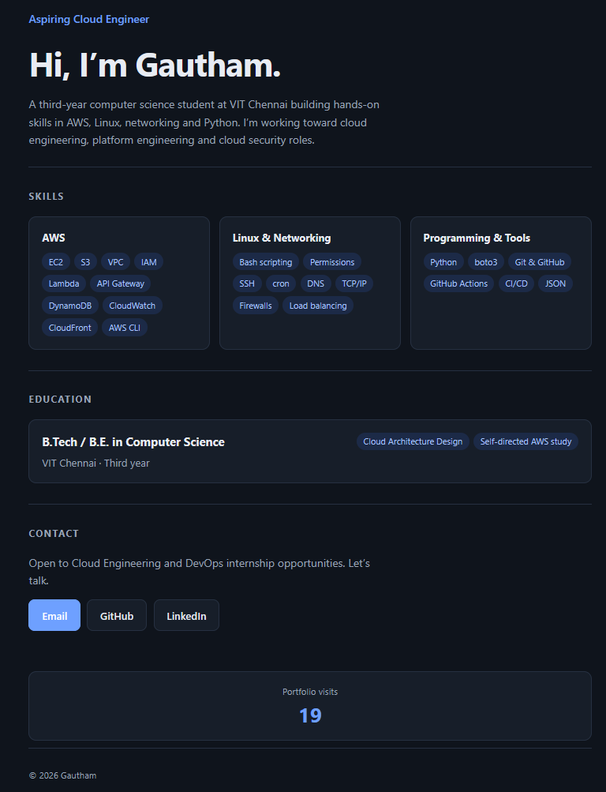
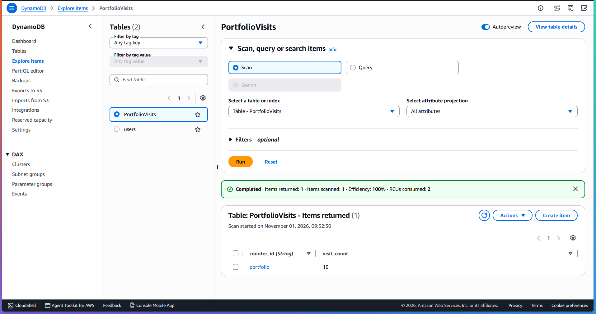
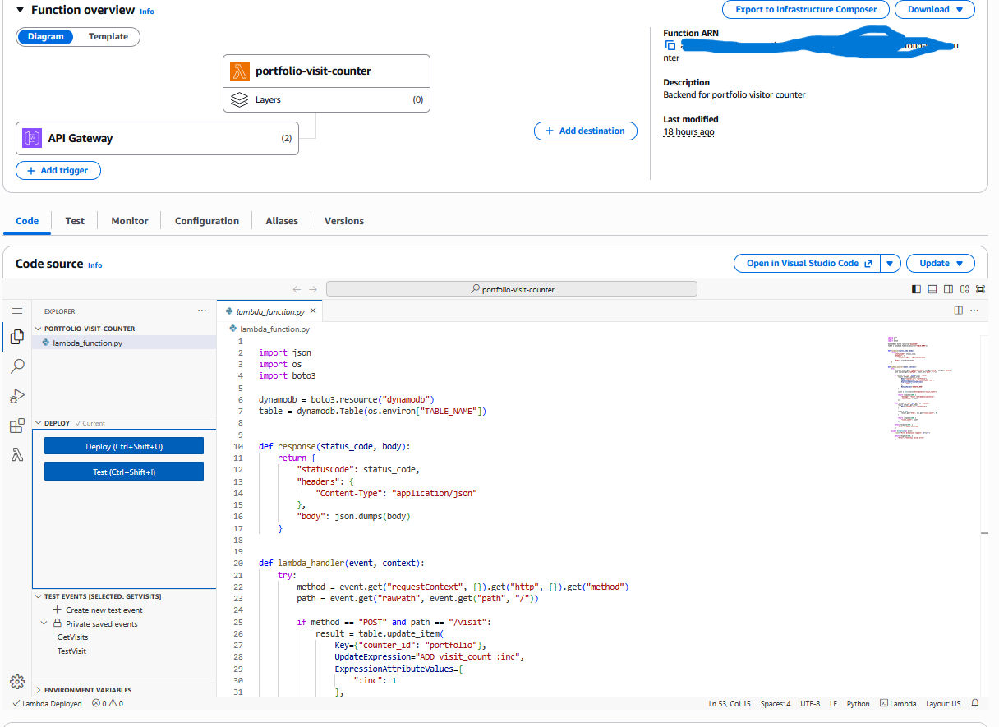
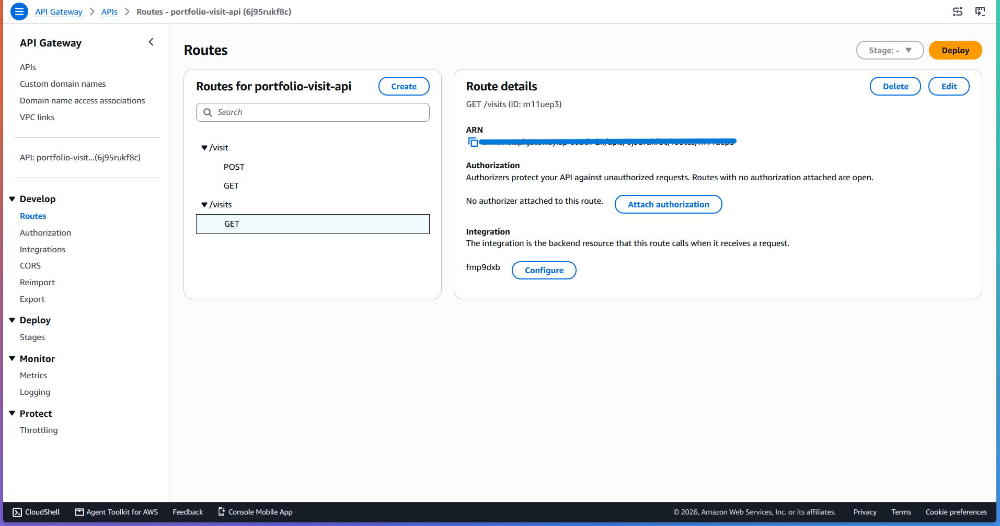
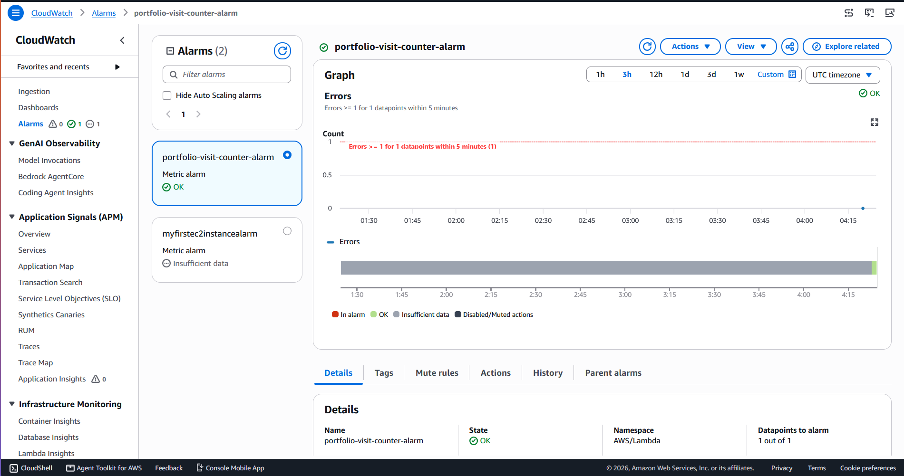

# AWS Serverless Visit Tracker

A serverless visitor counter integrated into my personal cloud engineering portfolio, built using AWS services.

The project demonstrates serverless application development, REST API integration, NoSQL database operations, monitoring, and cloud deployment.

## Live Demo

**Portfolio:** https://d2k2wmhtz9z5bn.cloudfront.net/

**GitHub Repository:** https://github.com/KarchellaGautham/ws-serverless-visit-tracker

## Architecture

[View Architecture Diagram](docs/architecture.md)

### Architecture Overview

The portfolio website is hosted on Amazon S3 and delivered through Amazon CloudFront.

The visitor counter communicates with a backend through API Gateway, which invokes an AWS Lambda function. Lambda updates or retrieves the visitor count stored in DynamoDB.

CloudWatch collects execution logs and monitors Lambda errors.

## AWS Services Used

| Service | Purpose |
|---|---|
| Amazon S3 | Static website hosting |
| Amazon CloudFront | Content delivery |
| API Gateway | HTTP API endpoints |
| AWS Lambda | Python backend logic |
| Amazon DynamoDB | Visitor count storage |
| AWS IAM | Access control |
| Amazon CloudWatch | Logging and monitoring |

## API Endpoints

| Method | Endpoint | Description |
|---|---|---|
| POST | `/visit` | Increments visitor count |
| GET | `/visits` | Retrieves current visitor count |

## Implementation

### 1. DynamoDB

Created a DynamoDB table named `PortfolioVisits` to store the visitor count.

- Partition key: `counter_id`
- Attribute: `visit_count`
- Atomic counter updates using `UpdateItem`

### 2. AWS Lambda

Implemented the backend using Python and Boto3.

The Lambda function:
- Handles POST requests to increment visits.
- Handles GET requests to retrieve the current count.
- Communicates with DynamoDB.
- Returns JSON responses.

### 3. API Gateway

Configured an HTTP API with:
- `POST /visit`
- `GET /visits`
- Lambda integrations
- CORS configuration
- Automatic deployment

### 4. Monitoring

Configured Amazon CloudWatch to:
- Collect Lambda execution logs.
- Monitor Lambda errors.
- Trigger an alarm when errors occur.
- Retain logs for 7 days.

## Screenshots

### Live Visitor Counter

### DynamoDB Table

### Lambda Function

### API Gateway Routes

### CloudWatch Alarm

## Testing

Verified the following:

- POST request successfully increments the visitor count.
- GET request retrieves the current count.
- Repeated requests correctly update the count.
- The portfolio displays the retrieved visitor count.
- CloudWatch alarm is configured and currently healthy.

## Key Learnings

- Building serverless applications using AWS Lambda.
- Integrating API Gateway with Lambda.
- Performing atomic updates in DynamoDB.
- Configuring IAM permissions.
- Deploying static websites using S3 and CloudFront.
- Monitoring serverless applications using CloudWatch.
- Debugging API integration and CORS issues.

## Future Improvements

- Infrastructure as Code using Terraform.
- Automated deployment using GitHub Actions.
- Improved API security and abuse protection.
- Additional monitoring and performance metrics.

---

**Author:** Gautham  
**Focus:** Cloud Engineering | AWS | DevOps
