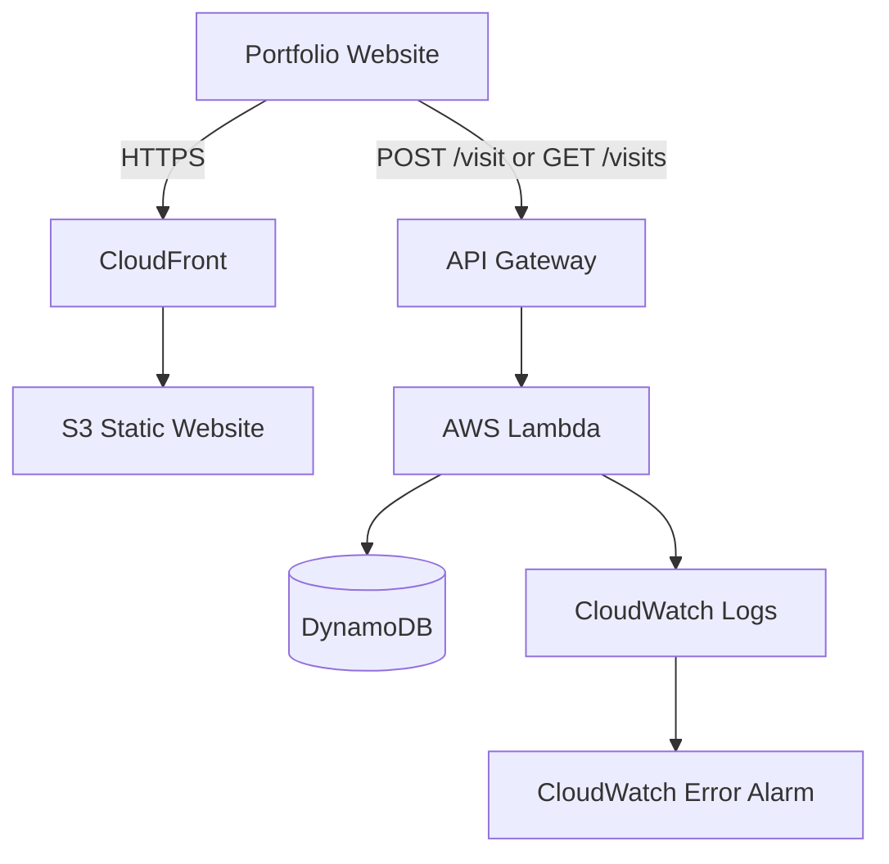

# AWS Serverless Visit Tracker — Architecture

## Overview

This project implements a serverless visitor counter for my personal portfolio website using AWS services.

## Architecture Diagram

## AWS Services

| Service | Responsibility |
|---|---|
| Amazon S3 | Stores portfolio website files |
| Amazon CloudFront | Content delivery over HTTPS |
| API Gateway | Exposes HTTP endpoints |
| AWS Lambda | Executes Python backend logic |
| DynamoDB | Stores visitor count |
| IAM | Controls service permissions |
| CloudWatch | Logs and monitors execution |

## Request Flow

### Increment Visitor Count

1. A visitor opens the portfolio.
2. JavaScript sends a POST request to `/visit`.
3. API Gateway invokes Lambda.
4. Lambda performs an atomic DynamoDB update.
5. DynamoDB returns the updated count.
6. Lambda sends the response through API Gateway.
7. JavaScript displays the count.

### Retrieve Visitor Count

1. A GET request is sent to `/visits`.
2. API Gateway invokes Lambda.
3. Lambda retrieves the DynamoDB item.
4. The current count is returned as JSON.

## API Endpoints

| Method | Path | Description |
|---|---|---|
| POST | `/visit` | Increment visitor count |
| GET | `/visits` | Retrieve visitor count |

## Security and Monitoring

- Restricted IAM permissions for DynamoDB.
- Private S3 bucket with CloudFront Origin Access Control.
- API Gateway CORS configuration.
- API Gateway throttling.
- CloudWatch logging and error alarm.
- Seven-day CloudWatch log retention.
